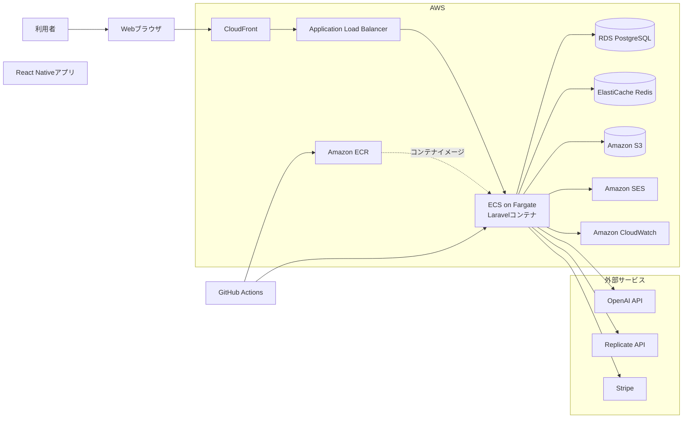
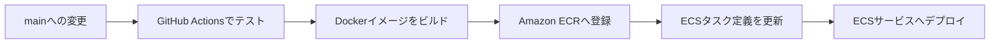

# MyTeacher

**タスクの実績を見える化し、子どものお小遣いを実績ベースで考えられるAIタスク管理プラットフォーム**

家族でタスクを共有し、タスクごとに設定した報酬と完了実績を記録します。保護者は、子どもが取り組んだタスクや獲得報酬を振り返りながら、お小遣いについて話し合えます。AIによるタスク分解やアバターのフィードバックを通じて、日々のタスクに楽しく取り組めることを目指しています。

> この報酬機能は、実績を記録・集計してお小遣いの判断を支援するものです。お小遣いの金額を自動決定するものではありません。

## 主な機能

- **実績に基づくお小遣い管理**：タスクごとに報酬を設定し、完了したタスクの報酬を実績として集計
- **家族でのタスク管理**：グループタスクを共有し、家事や家庭内の役割分担を管理
- **AIタスク分解**：大きなタスクを、取り組みやすい小さなタスクに分解
- **実績の可視化**：タスクの完了数や獲得報酬を週・月・年単位で確認
- **アバターによるフィードバック**：タスクのイベントに応じてコメントや画像を表示
- **Web・モバイルアプリ開発**：Webアプリを提供。React Nativeアプリも開発していますが、現在は未デプロイです
- **決済・サブスクリプション**：Stripeを利用したプラン・決済管理

## アプリURL

- [MyTeacher](https://my-teacher-app.com/)


## システム構成

以下はアプリケーションとデプロイ経路の論理構成です。AWSリソースの配置や冗長化など、個別の設定を表すものではありません。



### CI/CDデプロイフロー



GitHub Actionsのデプロイワークフローは、テスト後にDockerイメージをビルドしてECRへ登録し、ECSのタスク定義とサービスを更新します。ワークフローの対象パスや実際のAWS環境設定は、運用に合わせて管理しています。

> React Nativeモバイルアプリは開発中で、現時点ではデプロイされていません。構成図は現在デプロイされているクライアント経路を示しています。

## 技術スタック

| 領域 | 技術 |
| --- | --- |
| バックエンド | PHP 8.3、Laravel 12 |
| アーキテクチャ | Action-Service-Repository |
| Webフロントエンド | Blade、Vanilla JavaScript、Tailwind CSS、Vite |
| モバイル | React Native |
| データベース | PostgreSQL |
| コンテナ | Docker |
| AWS | ECS Fargate、ECR、RDS、ElastiCache、S3、SES、CloudWatch |
| CI/CD | GitHub Actions |
| AI機能 | OpenAI API、Replicate API |
| 決済 | Stripe |
| テスト・静的解析 | Pest、SQLiteインメモリDB、Larastan |

## 技術選定の理由

### Action-Service-Repositoryパターン

HTTPリクエストの受付、業務ロジック、データアクセスを分け、変更の影響範囲を明確にするために採用しています。Actionを入口として、ビジネスルールはService、データアクセスはRepositoryに配置します。

### DockerとECS Fargate

アプリケーションをコンテナとしてビルド・配布し、AWS上ではサーバーのプロビジョニングやOS管理を抑えながら実行するために採用しています。ECRとECSを組み合わせ、イメージ登録からサービス更新までをCI/CDにつなげています。

### PostgreSQLとマネージドAWSサービス

アプリケーションの永続データにはPostgreSQLを利用し、データベース、キャッシュ、オブジェクトストレージ、メール、ログ・メトリクスの責務を分けています。各サービスの設定値や可用性構成は環境ごとに管理します。

### SQLiteインメモリDBによるテスト

テスト実行時に開発・本番DBへの接続を避け、CI上でも再現しやすい環境にするため、SQLiteインメモリDBを利用しています。

### Vanilla JavaScript

Webフロントエンドでは追加のJavaScriptフレームワークへの依存を抑え、既存画面との互換性と保守性を重視しています。

## AIエージェントを活用した開発

GitHub Copilotを単発のコード生成にとどめず、リポジトリ固有の設計ルールや開発手順を参照できる形で整備しています。

- **常時適用の指示**：プロジェクト構成、アーキテクチャ、共通ルールを共有
- **ファイル種別ごとの指示**：Action、Service、Repository、テスト、モバイルなどの実装規約を対象に応じて適用
- **タスク別プロンプト**：不具合調査、実装後レビュー、設計差分確認などの作業手順を定型化
- **段階的な進め方**：調査・提案を行い、方針確認後に設計・実装へ進む
- **人による確認と検証**：提案や差分を確認し、関連テスト・静的解析を実行

AIに判断や変更を丸投げするのではなく、リポジトリのルール・承認タイミング・検証方法を明示して、開発プロセスに組み込んでいます。プロジェクト固有のCopilot設定は [`.github/README.md`](.github/README.md) を参照してください。

## 開発で苦労した点と対応

### Laravelの知見を活かしたReact Nativeアプリ開発

React Nativeもスマートフォンアプリ開発も初めての挑戦でした。先に開発したWebアプリの機能やLaravel APIの仕様を手がかりに、既存の業務ロジックを活かしながら、モバイルでも同じ操作・体験を実現することを目指しました。

特に、モバイルアプリ向けのテスト環境を整えることや、Webとモバイルで画面遷移・入力・API連携の動作をそろえることに苦労しました。まずWebアプリを一通り開発し、その後React Nativeで機能を実装。実機を使って操作を繰り返し確認し、見つかった差異や不具合を修正するサイクルを重ねて、両アプリの操作を近づけました。

### モバイルとAPIのレスポンス整合

APIの通信が成功していても、レスポンスのキー形式や必要な項目がクライアント側の期待と異なると画面には正しく表示されません。APIレスポンスとモバイル側のデータモデルを照合して原因を特定し、必要なデータ形式を整えました。

### AI機能のアプリケーションへの統合

AI APIの応答を返すだけでなく、応答のパース、利用量の記録、トークン管理との連携を実装しています。外部APIのモデルや応答形式の変更にも追従できるよう、呼び出し処理をサービス層にまとめています。

## ローカル開発

### 必要なもの

- PHP 8.3
- Composer
- Node.js / npm
- PostgreSQL（またはプロジェクトのDocker開発環境）

### セットアップ

```bash
composer install
npm install
cp .env.example .env
php artisan key:generate
```

`.env`にローカルDB等の接続情報を設定した後、プロジェクトの開発環境に合わせてマイグレーションを実行し、アプリケーションを起動してください。利用可能な開発用スクリプトは次のとおりです。

```bash
composer dev
```

## テスト・品質確認

```bash
CACHE_STORE=array DB_CONNECTION=sqlite DB_DATABASE=:memory: php artisan test
vendor/bin/phpstan analyse
```
